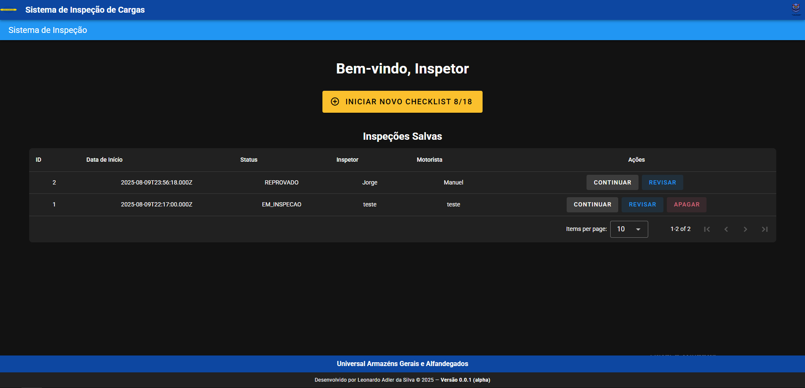
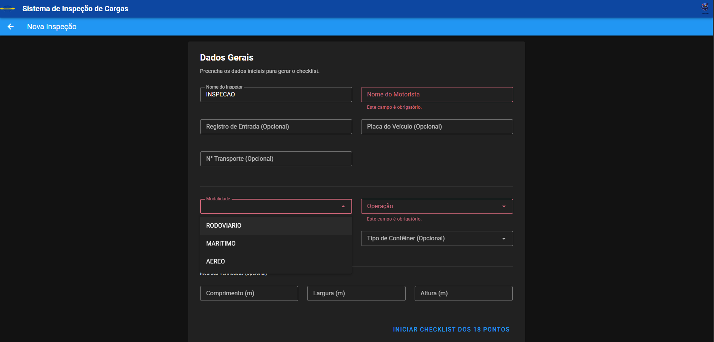
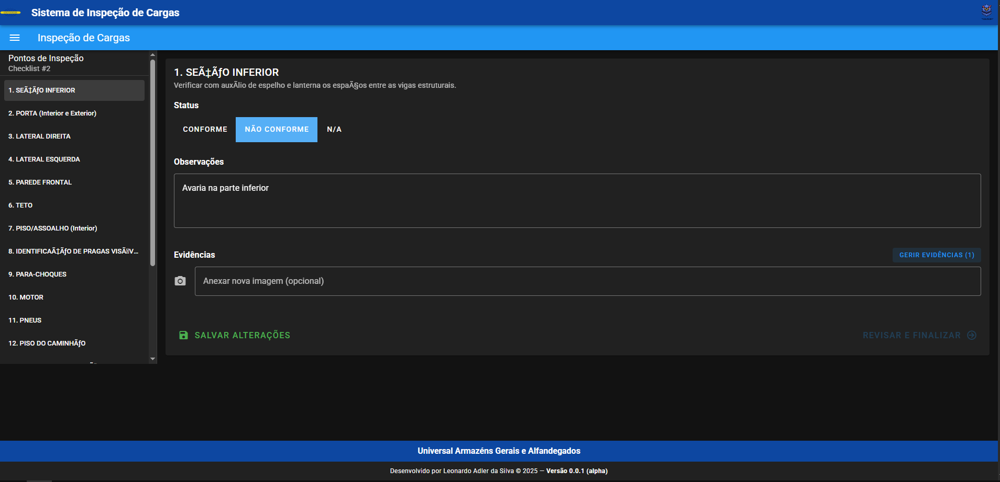
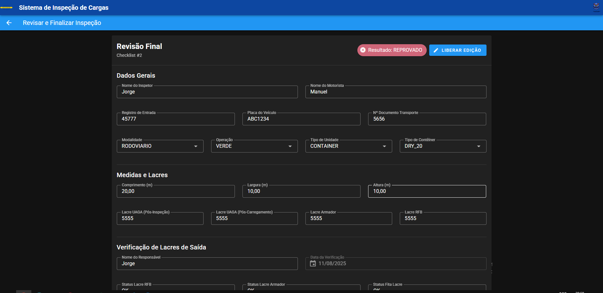
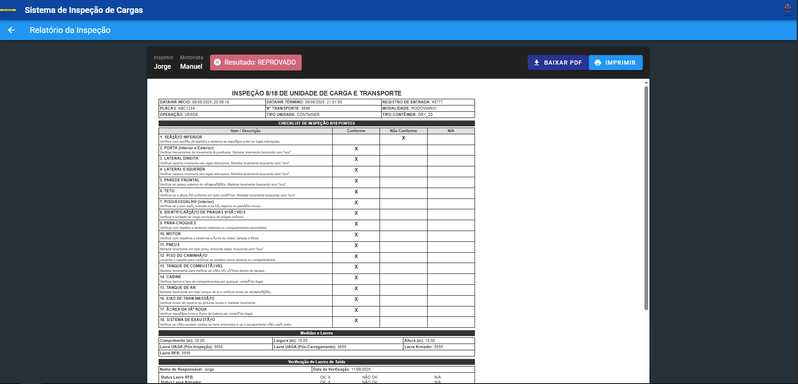
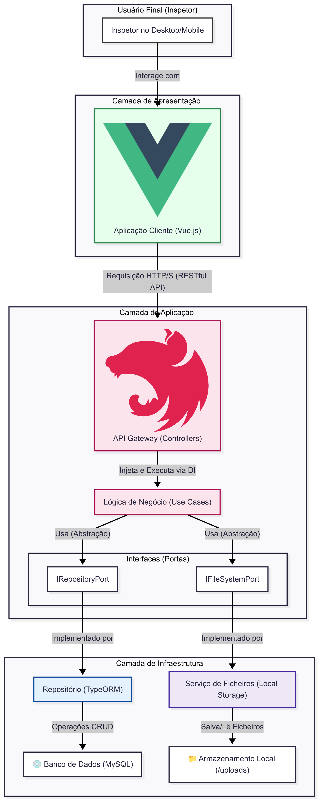
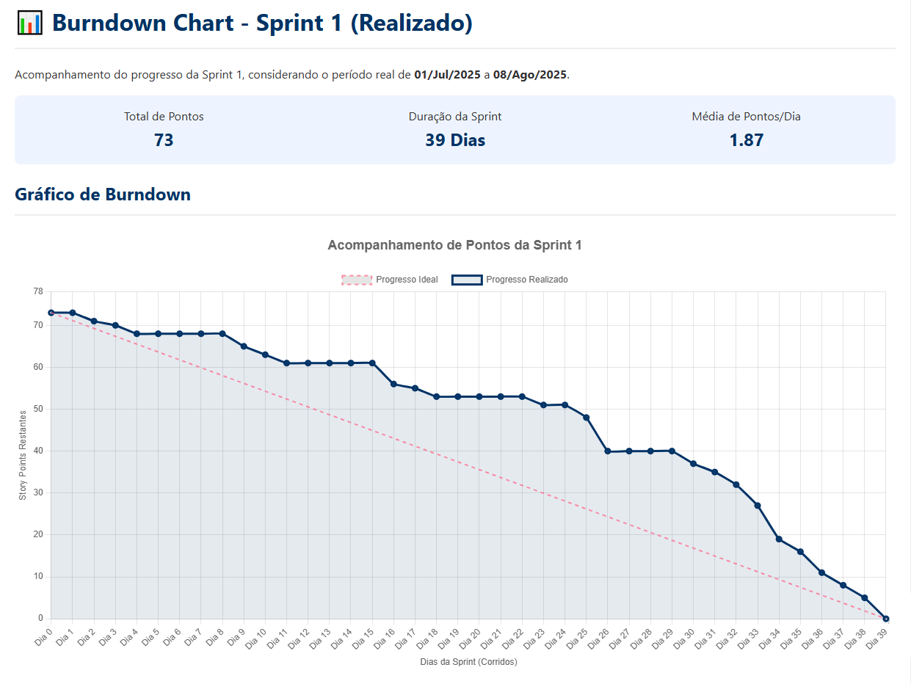

    
    
    <h1 align="center">Aplicação para Inspeção Digital 8/18</h1>
    

        <strong>Versão 0.0.1-alpha</strong> 
        <em>Sprint 1 Concluída em: 08 de Agosto de 2025</em>
    

    

        
        
        
    

    Este projeto foi idealizado, gerido e desenvolvido por <strong>Leonardo Adler da Silva</strong>, Analista de
    Sistemas I na Universal Armazéns Gerais e Alfandegados.
    Atuando em um papel híbrido, foi responsável pelo ciclo de vida completo do MVP: desde o levantamento de requisitos
    (Product Owner), passando pelo planeamento ágil e rituais (Scrum Master), até o desenvolvimento completo da solução
    (Fullstack Developer).

<h2 id="sumario">📜 Sumário</h2>
<ul>
    <li><a href="#visao-geral">Visão Geral: Da Necessidade à Plataforma</a></li>
    <li><a href="#entregue-na-versao-alpha">O Que Foi Entregue na versão Alpha</a></li>
    <li><a href="#tecnologias">Tecnologias e Ferramentas</a></li>
    <li><a href="#jornada-dos-usuarios">A Jornada dos Usuarios</a></li>
    <li><a href="#arquitetura">Arquitetura da Solução (Visão Geral)</a></li>
    <li><a href="#executar-aplicacao">Como Executar a Aplicação</a></li>
    <li><a href="#documentacao">Documentação Completa</a></li>
    <li><a href="#gestao-sprint-1">Gestão da Sprint 1</a></li>
    <li><a href="#proximos-passos">Próximos Passos</a></li>
    <li><a href="#autor">Autor</a></li>
    <li><a href="#licenca">Licença</a></li>
</ul>

<h2 id="visao-geral">📝 Visão Geral: Da Necessidade à Plataforma</h2>

    O ponto de partida para este projeto foi a necessidade crítica de digitalizar o processo de <strong>inspeção
        alfandegária 8/18</strong>. Historicamente realizado em formulários físicos, este método manual apresentava
    desafios significativos: risco de perda de documentos, dificuldade na rastreabilidade e, crucialmente, a
    <strong>impossibilidade de anexar evidências fotográficas</strong> de forma ágil.

    A visão do projeto evoluiu de uma solução única para uma <strong>Plataforma de Inspeções Digitais</strong>, capaz de
    suportar múltiplos tipos de
    checklists. Esta expansão de escopo é possível graças à escolha estratégica de se utilizar <strong>Domain-Driven
        Design (DDD)</strong> e uma
    <strong>arquitetura desacoplada</strong>. O módulo de <strong>Inspeção 8/18</strong> é,
    portanto, o primeiro e fundamental passo desta jornada, servindo como o MVP que valida o conceito da plataforma.

<h2 id="entregue-na-versao-alpha">🏆 O Que Foi Entregue na Versão Alpha</h2>

A primeira versão do projeto, entregue na Sprint 1, focou em construir e validar o fluxo de valor mais crítico da
    operação. O sistema nesta fase já permite:

<ul>
    <li>✅ <strong>Criação e Gestão de Inspeções:</strong> Iniciar, editar e apagar inspeções em andamento.</li>
    <li>✅ <strong>Checklist Digital Completo:</strong> Avaliar todos os 18 pontos padrão, adicionando status,
        observações e evidências.</li>
    <li>✅ <strong>Gestão de Evidências Fotográficas:</strong> Anexar, visualizar, baixar e excluir múltiplas fotos para
        cada item.</li>
    <li>✅ <strong>Finalização Inteligente:</strong> O sistema calcula automaticamente o resultado final
        (Aprovado/Reprovado).</li>
    <li>✅ <strong>Geração de Relatórios PDF:</strong> Ao finalizar, um relatório PDF fiel ao formulário oficial é gerado
        e armazenado.</li>
</ul>

<strong>Visualização das Telas Entregues na Versão Alpha:</strong>

<table width="100%">
    <tr>
        <td align="center" width="50%">
            <b>Tela 1: Inicial</b> 
            Visualização e criação de novas inspeções.
              
            
        </td>
        <td align="center" width="50%">
            <b>Tela 2: Nova Inspeção</b> 
            Coleta de dados primários da inspeção.
              
            
        </td>
    </tr>
    <tr>
        <td align="center" colspan="2">
             
            <b>Tela 3: Checklist 18 Pontos</b> 
            O coração da aplicação, onde cada ponto é avaliado.
              
            
        </td>
    </tr>
    <tr>
        <td align="center" width="50%">
             
            <b>Tela 4: Revisar e Finalizar</b> 
            Tela de revisão final antes da conclusão.
              
            
        </td>
        <td align="center" width="50%">
             
            <b>Tela 5: Relatório Gerado</b> 
            Confirmação e link para o PDF final.
              
            
        </td>
    </tr>
</table>

<h2 id="tecnologias">🛠️ Tecnologias e Ferramentas</h2>

A aplicação foi construída com uma stack moderna e robusta, focada em performance, escalabilidade e qualidade de
    código.

<table border="1" style="border-collapse: collapse; width:100%;">
    <thead>
        <tr bgcolor="#f2f2f2">
            <th align="left">Área</th>
            <th align="left">Tecnologia Principal</th>
            <th align="left">Testes</th>
            <th align="left">Detalhes</th>
        </tr>
    </thead>
    <tbody>
        <tr>
            <td><strong>Backend</strong></td>
            <td><code>NestJS</code></td>
            <td><code>Jest</code> (Unitário & E2E)</td>
            <td>Node.js, TypeScript, TypeORM, Arquitetura Limpa, DDD, SOLID.</td>
        </tr>
        <tr>
            <td><strong>Frontend</strong></td>
            <td><code>Vue.js</code></td>
            <td><code>Vitest</code> (Unitário) + <code>Cypress</code> (E2E)</td>
            <td>Node.js, TypeScript, Vuetify, Pinia para gestão de estado.</td>
        </tr>
        <tr>
            <td><strong>Banco de Dados</strong></td>
            <td><code>MySQL</code></td>
            <td>N/A</td>
            <td>Banco de dados relacional para persistência dos dados da inspeção.</td>
        </tr>
        <tr>
            <td><strong>DevOps & CI/CD</strong></td>
            <td><code>Podman / Docker Compose</code></td>
            <td>Scripts de Entrypoint</td>
            <td>Ambiente de desenvolvimento 100% containerizado e pipeline de CI "Test-Before-Run".</td>
        </tr>
    </tbody>
</table>

<h2 id="jornada-dos-usuarios">🗺️ As Jornadas dos Usuários: O Fluxo de Trabalho Completo</h2>

    Com a evolução do projeto para uma plataforma, a aplicação agora suporta um fluxo de trabalho completo e
    multi-etapas, envolvendo diferentes perfis de usuários. Cada perfil tem uma jornada específica e um conjunto de
    responsabilidades, garantindo a integridade e a rastreabilidade do processo do início ao fim.

<h4><strong>1. A Jornada do Documental (O Ponto de Partida)</strong></h4>
<ol>
    <li><strong>Login e Dashboard:</strong> O usuário do setor Documental acede ao sistema e visualiza um dashboard com
        as inspeções sob sua gestão.</li>
    <li><strong>Criação da Inspeção:</strong> Ele inicia o processo clicando em "Criar Nova Inspeção", preenchendo os
        dados primários (modalidade, tipo de operação, tipo de contêiner, etc.). Ao salvar, a inspeção é criada com o
        status <strong>"Aguardando Inspeção"</strong>.</li>
    <li><strong>Validação e Liberação:</strong> Após o inspetor completar o checklist, a inspeção retorna para o
        Documental (ou Admin) com o status <strong>"Aguardando Validação"</strong>. Ele revisa e aprova, movendo a
        inspeção para a próxima etapa. Ele também realiza etapas cruciais de deslacre para a fiscalização da Receita
        Federal.</li>
</ol>

<h4><strong>2. A Jornada do Inspetor (O Coração da Verificação)</strong></h4>
<ol>
    <li><strong>Login e Fila de Trabalho:</strong> O Inspetor acede ao sistema e visualiza em sua tela inicial uma lista
        de inspeções com o status <strong>"Aguardando Inspeção"</strong>.</li>
    <li><strong>Início da Atividade:</strong> Ele seleciona uma inspeção da lista para começar o trabalho. A primeira
        etapa é registrar as <strong>dimensões verificadas</strong> do contêiner.</li>
    <li><strong>Execução do Checklist:</strong> O inspetor realiza a verificação dos <strong>8, 11 ou 18
            pontos</strong>, registrando status, observações, métodos de verificação (sub-itens) e evidências, seguindo
        todas as regras de negócio de validação.</li>
    <li><strong>Submissão para Validação:</strong> Ao completar o checklist, ele o finaliza. O sistema pede uma
        confirmação e, uma vez confirmada, bloqueia o checklist para edições e muda o status para <strong>"Aguardando
            Validação"</strong>.</li>
    <li><strong>Lacração Pós-Inspeção:</strong> Após a aprovação do Documental/Admin, a inspeção aparece para o inspetor
        com o status <strong>"Aprovado para Lacração"</strong>. Ele então acede ao módulo de lacres para registrar o
        primeiro lacre e suas 3 evidências fotográficas obrigatórias. Aqui termina sua participação no fluxo.</li>
</ol>

<h4><strong>3. A Jornada do Conferente (A Operação de Carga)</strong></h4>
<ol>
    <li><strong>Login e Fila de Trabalho:</strong> O Conferente visualiza as inspeções que estão no estado
        <strong>"Aguardando Carregamento"</strong>.</li>
    <li><strong>Deslacre e Carregamento:</strong> Ele seleciona uma inspeção, registra o deslacre (com nome e
        assinatura) e a equipe realiza o carregamento da unidade (processo offline).</li>
    <li><strong>Relacre Pós-Carregamento:</strong> Após o carregamento, ele acede novamente à inspeção, registra o novo
        lacre e anexa as 3 evidências fotográficas obrigatórias.</li>
    <li><strong>Verificação de Precinto:</strong> Mais adiante no fluxo, após a liberação do Documental, a inspeção
        aparece para o Conferente com o status <strong>"Aguardando Verificação de Precinto"</strong>. Ele realiza a
        checagem final do precinto, anexa as fotos e libera o veículo para a portaria.</li>
</ol>

<h4><strong>4. A Jornada da Portaria (A Saída Final)</strong></h4>
<ol>
    <li><strong>Interface Simplificada:</strong> O usuário da Portaria acede a uma tela dedicada e simplificada, vendo
        apenas os veículos com o status <strong>"Liberado para Saída"</strong>.</li>
    <li><strong>Verificação dos Lacres de Saída:</strong> Ele seleciona o veículo e segue um checklist simples para
        verificar os lacres fiscais (RFB, Armador, Fita), anexando as evidências fotográficas obrigatórias para cada um.
    </li>
    <li><strong>Finalização do Processo:</strong> Ao confirmar a verificação, ele registra a data/hora de saída, e a
        inspeção é movida para o estado <strong>"Finalizado"</strong>, concluindo em definitivo todo o seu ciclo de
        vida.</li>
</ol>

<h4><strong>5. A Jornada do Admin (A Visão Completa)</strong></h4>
<ol>
    <li><strong>Visão Global:</strong> O Admin tem acesso a um dashboard que mostra <strong>todas</strong> as inspeções
        em <strong>todos</strong> os status, podendo filtrar e intervir em qualquer etapa do processo.</li>
    <li><strong>Ações de Supervisão:</strong> Pode executar as mesmas ações que os outros perfis (ex: validar uma
        inspeção no lugar do Documental).</li>
    <li><strong>Gestão de Usuários:</strong> Possui acesso a uma área de "Administração" exclusiva, onde pode
        <strong>criar, editar e gerir os usuários</strong> do sistema e seus respectivos papéis (perfis de acesso).</li>
</ol>

<h2 id="arquitetura">🏛️ Arquitetura da Solução (Visão Geral)</h2>

    A aplicação foi projetada sobre uma <strong>arquitetura de 3 camadas desacoplada</strong>, priorizando a
    manutenibilidade, escalabilidade e a clara separação de responsabilidades.

    

    O coração do sistema é a API (Backend), construída com <strong>Clean Architecture</strong> e <strong>DDD</strong>,
    garantindo que as regras de negócio sejam independentes da infraestrutura. O Frontend é um cliente desacoplado
    focado na experiência do usuário, e a camada de infraestrutura (banco de dados, armazenamento) é tratada como um
    detalhe "plugável".

    A qualidade é garantida por um pipeline de <strong>Integração Contínua (CI)</strong> que executa a suíte completa de
    testes antes de qualquer serviço iniciar.

    Para uma análise técnica minuciosa de cada componente, com diagramas de classe e dicionário de dados, consulte a <a
        href="#documentacao"><strong>Documentação Completa</strong></a>.

<h2 id="executar-aplicacao">🚀 Como Executar a Aplicação Localmente</h2>

    Graças à containerização, todo o ambiente de desenvolvimento pode ser configurado e executado com apenas alguns
    comandos.

<h3>✅ Pré-requisitos</h3>
<ul>
    <li><strong>Git</strong></li>
    <li><strong>Podman + Podman Compose</strong> (Recomendado) OU <strong>Docker + Docker Compose</strong></li>
</ul>

<h3>⚙️ Instruções de Execução</h3>
<ol>
    <li><strong>Clone o repositório:</strong>
        <pre><code>git clone "linkDoRepositorio"</code></pre>
    </li>
    <li><strong>Entre no diretório do projeto:</strong>
        <pre><code>cd nome-do-repositorio</code></pre>
    </li>
    <li><strong>Construa e inicie a aplicação:</strong>
        <pre><code>podman-compose up --build --no-cache</code></pre>
    </li>
</ol>

<h3>✅ Acesso à Aplicação</h3>

Após a inicialização, a aplicação estará pronta para uso:

<ul>
    <li>🖥️ <strong>Interface Gráfica (Frontend):</strong> <a
            href="http://localhost:3000"><strong>http://localhost:3000</strong></a></li>
    <li>📡 <strong>Documentação da API (Backend):</strong> <a
            href="http://localhost:8888/api"><strong>http://localhost:8888/api</strong></a></li>
</ul>

    Para instruções detalhadas, desenvolvimento focado e troubleshooting, consulte o <a
        href="./CONTRIBUTING.md"><strong>Guia de Contribuição</strong></a>.

<h2 id="documentacao">📚 Documentação Completa</h2>

Toda a documentação do projeto está centralizada para fácil acesso e consulta.

<table width="100%">
    <tr align="center">
        <td width="50%" valign="top">
            <h4>Gestão de Projeto & Processos</h4>
            <ul>
                <li align="left">📖 <strong><a href="./docs/PRODUCT_BACKLOG.md">Product Backlog e Sprints</a></strong>:
                    Acompanhe as Histórias de Usuário e o planeamento das Sprints.</li>
                <li align="left">🤝 <strong><a href="./CONTRIBUTING.md">Guia de Contribuição</a></strong>: Regras de
                    branch, processo de PR e nosso Contrato de Qualidade (DoD).</li>
                <li align="left">🏛️ <strong><a href="./docs/ARCHITECTURE.md">Arquitetura Detalhada</a></strong>: Uma
                    análise aprofundada da arquitetura da solução.</li>
            </ul>
        </td>
        <td width="50%" valign="top">
            <h4>Documentação Técnica</h4>
            <ul>
                <li align="left">⚙️ <strong><a href="./checklist-8-18-back/README.md">Backend (NestJS)</a></strong>:
                    Detalhes da API, endpoints e lógica de negócio.</li>
                <li align="left">🎨 <strong><a href="./checklist-8-18-front/README.md">Frontend (Vue.js)</a></strong>:
                    Componentes, gestão de estado e fluxo de telas.</li>
                <li align="left">🗃️ <strong><a href="./checklist-8-18-bd/README.md">Banco de Dados
                            (MySQL)</a></strong>: MER, Dicionário de Dados e Scripts.</li>
            </ul>
        </td>
    </tr>
</table>

<h2 id="gestao-sprint-1">📈 Gestão da Sprint 1</h2>

    O desenvolvimento da fase alpha ocorreu entre <strong>01 de Julho de 2025</strong> e <strong>08 de Agosto de
        2025</strong>.
    A entrega foi concluída com sucesso, cobrindo 100% do escopo planeado.

    
<strong>Clique para visualizar o Gráfico Burndown da Sprint 1</strong>

     
    

        
    

<h2 id="proximos-passos">🚀 Próximos Passos: Sprint 2 (Rumo à Homologação)</h2>

    Com a conclusão da Sprint 1 e o refinamento dos requisitos com a coordenação de TI, o projeto entra na
    <strong>Sprint 2</strong>, a fase final de desenvolvimento antes da homologação com os usuários.

<ul>
    <li>
        <strong>Status:</strong> 
    </li>
    <li>
        <strong>Período:</strong> 18 de Agosto de 2025 – 12 de Setembro de 2025.
    </li>
    <li>
        <strong>Meta:</strong> Entregar uma versão <strong>MVP (Minimum Viable Product)</strong> robusta e completa,
        pronta para ser validada em campo pela equipe de inspetores.
    </li>
</ul>

<h4>Principais Entregas da Sprint 2:</h4>

Ao final desta Sprint, a aplicação contará com as seguintes novas funcionalidades:

<ul>
    <li>
        <strong>✅ Sistema de Autenticação:</strong> Acesso à aplicação protegido por login e senha, garantindo a
        segurança e o rastreio de quem realiza cada inspeção.
    </li>
    <li>
        <strong>✅ Assinaturas 100% Digitais:</strong> O inspetor e o motorista poderão assinar diretamente na tela do
        dispositivo, <strong>eliminando por completo a necessidade do formulário em papel</strong>.
    </li>
    <li>
        <strong>✅ Checklists Inteligentes (8 ou 18 Pontos):</strong> A aplicação apresentará automaticamente o checklist
        correto (8 pontos para contêineres em operações marítimas/aéreas ou 18 pontos completos para operações
        rodoviárias).
    </li>
    <li>
        <strong>✅ Relatórios Aprimorados:</strong> O relatório principal em PDF será gerado dinamicamente para 8 ou 18
        pontos. Além dele, será possível gerar um novo <strong>Relatório Fotográfico</strong> contendo apenas as imagens
        de evidência.
    </li>
    <li>
        <strong>✅ Melhorias de Usabilidade:</strong> A navegação entre os itens do checklist será guiada e o anexo de
        fotos será limitado a uma por item para simplificar o processo.
    </li>
    <li>
        <strong>✅ Ambiente de Homologação:</strong> A aplicação será implantada em um ambiente de testes estável,
        acessível via link, pronto para o uso e validação pela equipe de operação.
    </li>
</ul>

    Para um acompanhamento detalhado das Histórias de Usuário, tarefas e o progresso da sprint, consulte o nosso
    <strong><a href="./docs/PRODUCT_BACKLOG.md">Product Backlog e Sprints</a></strong>.

<h2 id="autor">👨‍💻 Autor</h2>

    <strong>Leonardo Adler da Silva</strong> 
    <em>Analista de Sistemas I at Universal Armazéns Gerais e Alfandegados</em>

<h2 id="licenca">📄 Licença</h2>

Este projeto é licenciado sob a <strong>Licença MIT</strong>.
